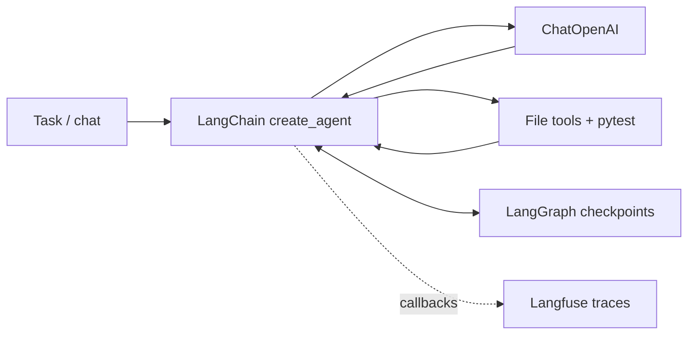

# Python coding harness

A local coding agent built with **LangChain** for the tool loop, **LangGraph** for
SQLite checkpoints, and **Langfuse** for model/tool traces and session grouping.
It can inspect a Python project, plan changes, create or edit source, run pytest,
and iterate on the results.

## Quick start

Requires Python 3.11+ and [uv](https://docs.astral.sh/uv/).

```sh
uv sync --locked
cp .env.example .env
```

Fill in `OPENAI_API_KEY`, `LANGFUSE_PUBLIC_KEY`, and `LANGFUSE_SECRET_KEY` in `.env`.
The Langfuse URL defaults to the EU cloud; change `LANGFUSE_BASE_URL` for another
region or a self-hosted instance. `.env` is read from your launch directory and
environment variables take precedence. The default model is `gpt-4.1-mini`;
override it with `HARNESS_MODEL` or `--model`.

```sh
uv run harness run --workspace /absolute/path/to/project --session fix-parser \
  "Inspect the parser, fix its handling of empty input, and run the relevant tests."

# Follow up using the same workspace and session label.
uv run harness run --workspace /absolute/path/to/project --session fix-parser \
  "Add a regression test for the edge case you fixed."

# Interactive mode; /exit or Ctrl-D leaves the session.
uv run harness chat --workspace /absolute/path/to/project --session development

# Use the model without exporting Langfuse traces.
uv run harness run --no-tracing --workspace /absolute/path/to/project \
  "Explain this project's structure."
```

The harness prints its session label at startup, tool activity to stderr, and the
final answer to stdout. If you omit `--session`, it generates a new label. Reuse
the printed label to continue. Sessions are scoped to the workspace's resolved path.
History is stored under `<workspace>/.harness/checkpoints.sqlite`; add `.harness/`
to the target project's `.gitignore`. A new session label starts a fresh conversation.
Use one process at a time per workspace/session.

`run_tests` uses the harness's Python interpreter by default. To use the target
project's dependencies, install pytest in that environment and select it:

```sh
uv run harness run --workspace /absolute/path/to/project \
  --test-python /absolute/path/to/project/.venv/bin/python \
  "Fix the failing tests."
```

## How it works



- `list_files`, `read_file`: browse source, including repository instructions.
- `write_file`: create a file without overwriting an existing one.
- `edit_file`: replace a unique exact match in an existing file.
- `run_tests`: execute pytest on a relative file/directory and return its exit
  status and bounded output. Failing tests are returned to the model for repair.
- `write_todos`: planning tool supplied by `TodoListMiddleware`.

Each invocation allows 20 model calls and 40 tool calls by default. Exceeding a
limit raises an error and makes the CLI exit nonzero. These are call counts, not
a dollar budget; provider retries can make extra HTTP requests. Model requests
have a 60-second timeout and up to two SDK retries. Each pytest process has a
60-second timeout, kills its process group on POSIX when that timeout expires,
and returns up to 24 KB of output. File tools accept UTF-8 files up to 1 MB.
Limits are configurable in `.env.example`.

Langfuse tracing attaches a fresh callback handler to every invocation, groups
traces by workspace/session, and prints a trace ID for lookup in Langfuse.
The SDK is shut down on CLI exit to flush queued events. With tracing enabled,
prompts, source snippets, edits, test output, and responses can be sent to the
configured Langfuse instance, as well as source context sent to the model provider.
Checkpoint history also contains this data locally. Trace delivery needs valid
credentials and connectivity; a printed ID alone does not prove ingestion succeeded.

## Execution boundary

Use this starter in a trusted local project and review its diff after a run.
File tools reject paths outside the workspace, resolve symlinks, and exclude
`.git`, virtual environments, `.harness`, `.env` files (except examples/templates),
and common credential/key paths. These checks prevent common accidental access;
they are **not a security sandbox**. Running pytest executes repository code with
your OS permissions. Tests can access files/network outside the workspace and
read secrets from disk even though the harness strips its own provider/tracing
environment variables from the subprocess. Use a disposable container or VM
before giving it untrusted repositories. Changes are applied directly; there is
no automatic rollback, arbitrary shell tool, deployment, or commit step.

## Development

```sh
uv run pytest -q
uv run ruff check .
uv run ruff format --check .
```

The test suite needs no API keys. It exercises the real LangChain graph with a
scripted tool-calling model, actual pytest subprocesses, SQLite reopen/resume,
session separation, file boundaries, error recovery, call limits, CLI streaming,
and real Langfuse callbacks with an in-memory OpenTelemetry exporter.
Live provider calls and Langfuse cloud ingestion require your credentials.

Code entry points:

| File | Responsibility |
| --- | --- |
| `src/coding_harness/agent.py` | Agent, prompt, middleware, checkpoints |
| `src/coding_harness/tools.py` | Workspace file tools and pytest execution |
| `src/coding_harness/tracing.py` | Langfuse client and invocation callbacks |
| `src/coding_harness/cli.py` | One-shot and interactive execution |
| `src/coding_harness/config.py` | Environment settings and limits |

Extend `build_tools` for your workflow, or supply another LangChain chat model
to `build_agent`. Before exposing side-effecting services, add explicit approval
or execution isolation appropriate to those services.

Official references: [LangChain agents](https://docs.langchain.com/oss/python/langchain/agents),
[middleware](https://docs.langchain.com/oss/python/langchain/middleware/built-in),
[checkpoint memory](https://docs.langchain.com/oss/python/langchain/short-term-memory),
and [Langfuse's LangChain integration](https://langfuse.com/integrations/frameworks/langchain).
